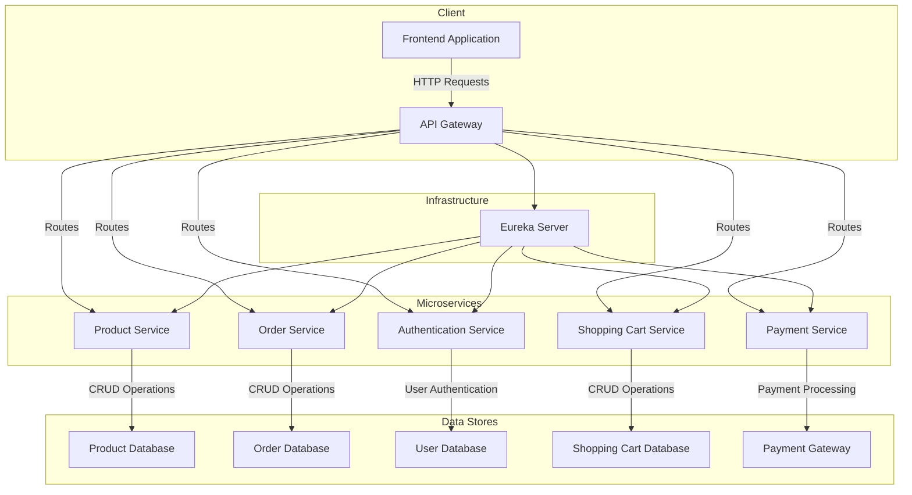
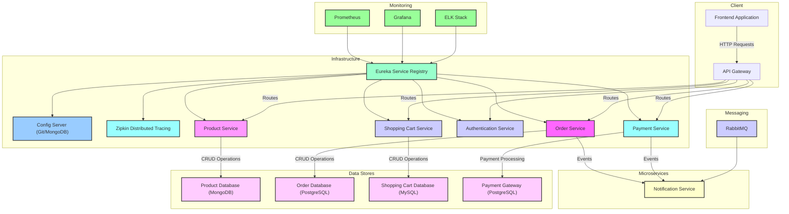
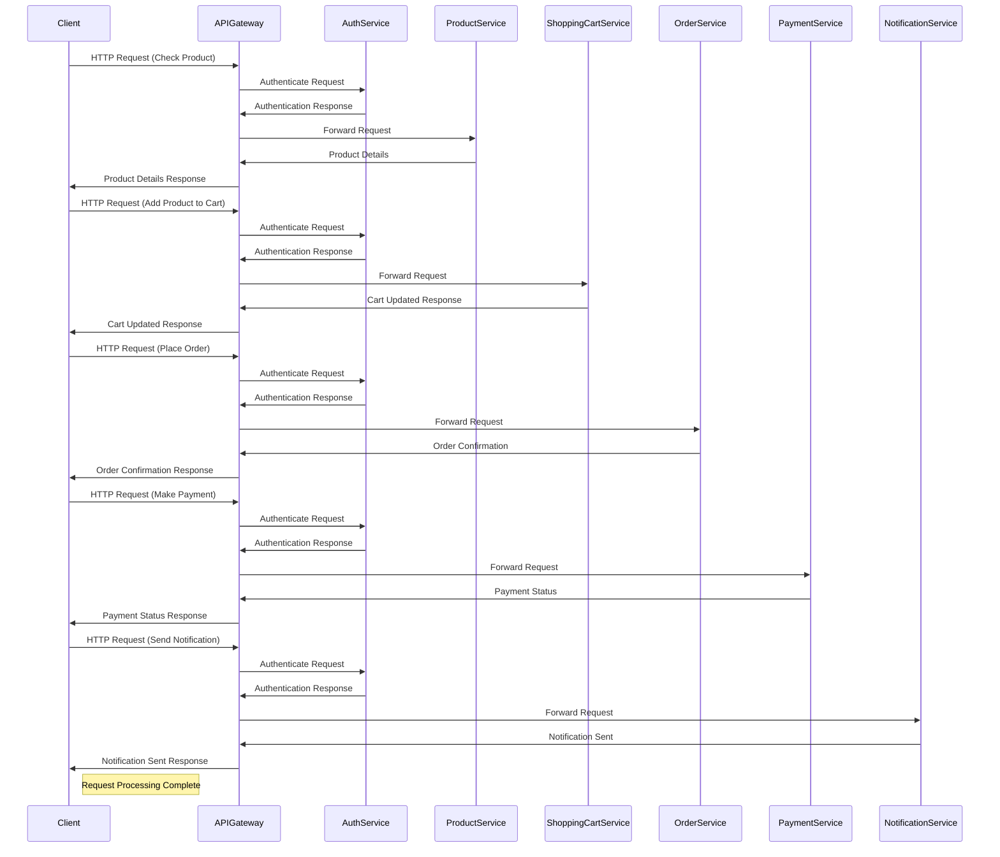

# java-se-training


## Best fit

```java
public class Demo{

    public void addTwoNumbers(int a, int b){
        int result = a + b;
        return result;
    }

    public static void main(String ...args){
        addTwoNumbers(5,10);
    }
}


```

## Functional Programming

```java

/*
? Represents a predicate (boolean-valued function) of one argument.
Predicate ->  boolean test(T t)

? Represents a predicate (boolean-valued function) of two arguments.
? This is the two-arity specialization of Predicate
BiPredicate ->  boolean test(T t, U u)

? Represents a function that accepts one argument and produces a result.
Function -> R apply(T t);

? Represents a function that accepts two arguments and produces a result.
? This is the two-arity specialization of Function.
BiFunction -> R apply(T t, U u);

? Represents an operation that accepts a single input argument and returns no result.
? Unlike most other functional interfaces, Consumer is expected to operate via side-effects.
Consumer -> void accept(T t);

? Represents an operation that accepts two input arguments and returns no result.
? This is the two-arity specialization of Consumer.
? Unlike most other functional interfaces, BiConsumer is expected to operate via side-effects.
BiConsumer -> void accept(T t, U u);

? Represents a supplier of results.
Supplier -> T get();

*/

```

---
marp: true
math: mathjax
paginate: true
size: 16:9
transition:  fade-out
description: Java Spring Boot 3 Microservices
author: John Oenga
url: https://oengajohn.github.io
transition: fade

---

# Java Spring Boot 3 Microservices

By: John Oenga

---



---



---



---

## Architecture Diagram Overview

## Components

### **API Gateway**

- Acts as the entry point for all incoming requests.
- Routes requests to the appropriate microservices based on defined rules.
- Responsible for authentication and authorization.

---

### Microservices

1. Product Service (MongoDB)
   Manages product information and performs CRUD operations on products.

2. Order Service (PostgreSQL)
    Handles order processing including creation, modification, and retrieval of orders.

3. Shopping Cart Service (MySQL)
    Manages shopping cart functionalities such as adding, updating, and removing items from the cart.

4. Payment Service (PostgreSQL)
    Processes payments for orders using external payment gateways.

5. Authentication Service
    Handles user authentication and issues access tokens.

6. Notification Service
    Sends notifications to users regarding order status, promotions, etc.

---

### Data Stores

- **Product Database (MongoDB)**: Stores product information.
- **Order Database (PostgreSQL)**: Stores order details.
- **Shopping Cart Database (MySQL)**: Stores shopping cart data.
- **Payment Gateway (PostgreSQL)**: Stores payment-related information.

### Infrastructure

- **Eureka Service Registry**: Used for service discovery and registration.
- **Config Server (Git/MongoDB)**: Centralized configuration management.
- **Zipkin Distributed Tracing**: Provides distributed tracing capabilities.
- **Prometheus**: Used for monitoring and alerting.
- **Grafana**: Provides visualization and analytics for monitoring data.
- **ELK Stack (Elasticsearch, Logstash, Kibana)**: Used for log aggregation and analysis.

---

- The Online Shopping Application leverages microservices architecture to provide scalability, flexibility, and maintainability. With the use of an API Gateway, centralized authentication, and distributed tracing and monitoring, the application ensures efficient request handling, security, and visibility into system performance

---

